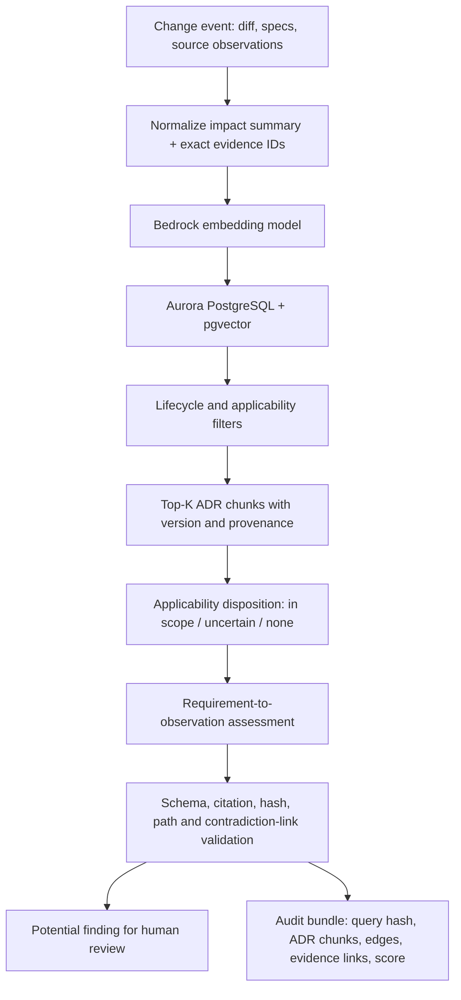

# ADR Scope Retrieval and Deviation Triage

This is the next simulation layer after the semantic-analysis PoC: use incoming change evidence to find potentially applicable ADR versions, then compare each retrieved normative requirement against auditable source observations.

## Important AWS boundary

**Amazon Bedrock creates embeddings and performs model inference; Aurora PostgreSQL with pgvector stores and searches the vectors.** Bedrock is not the vector database or a proxy in front of Aurora. The caller embeds a change/evidence query through Bedrock, then issues a metadata-filtered cosine-similarity query to Aurora. The local simulator replaces both AWS calls with a deterministic lexical retrieval baseline.

## Pipeline

The key separation is that **retrieval scope is not a deviation finding**. An ADR can be relevant but not violated, and a highly similar retired ADR must never become the governing decision. The current simulation refuses to emit `supported_deviation`; the production path should promote a model-proposed finding only after the existing evidence and provenance guards pass.

## Local reproducible simulation

No AWS resources, credentials, database, or additional dependencies are required for this run:

    python .poc/scope/run_scope.py --output-dir /tmp/adr-scope-report

It reads:

- `.poc/scope/adr_catalog.jsonl`: eight versioned ADR chunks with lifecycle and applicability metadata plus transparent demo control cues.
- `.poc/scope/scenarios.jsonl`: eight labeled events with repository/service/domain/language, changed paths, change summary and illustrative source observations.
- `.poc/scope/retrieval.py`: hard metadata filters followed by a lexical ranking baseline.
- `.poc/scope/run_scope.py`: retrieval plus conservative, cue-based triage; generates Markdown and JSON reports.
- `.poc/tests/test_scope.py`: assertions for lifecycle exclusion, metadata filtering, retrieval, evidence hashes and non-promotion of flags.

The report includes candidate ADR IDs and versions, lexical relevance scores, reasons, excluded ADRs, matched cues, evidence path/line/excerpt/hash, and a catalog hash. The cue matcher is intentionally limited and transparent; a match only creates a `potential_deviation` candidate. A missing cue does not prove compliance.

Run the full scope test set:

    python -m unittest discover -s .poc/tests -p "test_scope.py" -v

GitHub Actions runs this simulation on relevant pull requests and uploads `scope-report.md` and `scope-report.json` as an artifact.

## ADR catalog shape

Each row is one immutable content chunk and version. A production record needs at least:

| Field | Purpose |
|---|---|
| `adr_id`, `adr_version`, `chunk_id` | Stable decision and chunk identity |
| `status`, `review_state`, `effective_from`, `effective_until` | Prevent drafts, superseded records and expired decisions from silently governing analysis |
| `repositories`, `services`, `domains`, `languages` | Hard applicability filters, with explicit wildcards only where approved |
| `chunk_text`, `normative_text`, `tags` | Retrieval context and the exact requirement text to assess |
| `embedding`, `embedding_model_id`, `embedding_dimensions` | Reproducibility for vector search |
| `source_path`, `source_sha256` | Provenance back to the canonical ADR artifact |
| `deviation_check` | Optional versioned deterministic rule cues; not a replacement for semantic assessment |

Split long ADRs into chunks around individual decisions/invariants, not arbitrary character windows. Each chunk should preserve its ADR ID/version, section heading, status, effective dates and source line span. Embeddings for different models or dimensions must not be mixed in the same vector index without an explicit migration plan.

## Retrieval decision rules

1. **Hard applicability gate first:** approved/current lifecycle; date validity; repository, service, domain and language. A high vector score cannot override an exclusion.
2. **Hybrid candidate generation:** query embedding from a compact summary of the change, technical-spec section, changed-file diff and resolved call-path evidence. Use pgvector top-K plus lexical/tag matches. Reciprocal-rank fusion or an explicit calibrated reranker is preferable to assuming cosine similarity and keyword scores share a scale.
3. **Applicability triage:** return `in_scope`, `uncertain`, or `not_in_scope` with reasons, matched metadata and ranked chunks. Keep the uncertain bucket. Similarity thresholds in this PoC are provisional routing controls, not probabilities.
4. **Assessment per candidate ADR:** provide only the selected normative text and the minimum source/diff/call-graph evidence needed. Require typed links from requirement evidence IDs to observation evidence IDs, with `contradicts`, `consistent_with`, or `uncertain` plus an explanation.
5. **Validate before flagging:** verify ADR version/status, source hashes, evidence artifact IDs and excerpt hashes, line ranges, call-edge reachability/resolution, typed evidence links, and required normative language. Preserve unresolved/dynamic edges as uncertainty.
6. **No applicable ADR is not proof of compliance:** report that retrieval found no sufficiently supported ADR; retain the event and retrieval audit so corpus/scope metadata can be corrected.

A good future policy is to create a review item for candidate conflicts and missing-applicability cases—not an automatic merge block—until the labeled corpus has independent reviewer dispositions and representative precision/recall measurements.

## Optional Aurora + Bedrock backend

The optional adapter is in `.poc/scope/aurora_backend.py`. It uses the AWS SDK credential chain for Bedrock embeddings, connects to Aurora PostgreSQL with TLS, and binds SQL parameters for all search input. By default, database authentication uses an RDS IAM auth token; set `ADR_DB_AUTH=password` only for environments that intentionally use password-based authentication.

1. Provision Aurora PostgreSQL with the pgvector extension and apply `.poc/scope/aurora_schema.sql`.
2. Ensure the embedding model used during ingestion matches `BEDROCK_EMBEDDING_MODEL_ID` and the schema's vector dimension. The example adapter defaults to a 1,024-dimension Titan Text Embeddings v2 vector; configure both ingestion and query paths identically if choosing another supported embedding model.
3. Ingest each accepted/current ADR chunk, including its version, lifecycle/applicability metadata, source hash, normative text and embedding. Updating an ADR inserts a new version and marks the previous version superseded in a controlled transaction.
4. Run from a network location that can reach the private Aurora endpoint. Configure `AWS_REGION`, `ADR_PGHOST`, `ADR_PGDATABASE`, `ADR_PGUSER`, and the RDS CA trust bundle via `PGSSLROOTCERT`. Grant the workload role only the required Bedrock model invocation permission and database connect/read permissions. IAM database authentication needs the matching database role grants.
5. Install `pip install -r .poc/scope/requirements-aws.txt` and run:

       python .poc/scope/run_scope.py --backend aurora --output-dir /tmp/adr-scope-live

The live path makes real Bedrock and Aurora requests and can incur AWS charges. Keep it opt-in; PR CI should stay offline by default. The adapter returns a vector similarity score, which is logged as retrieval similarity—not model confidence, applicability probability, or violation likelihood.

The SQL DDL assumes a 1,024-dimension vector column. If a different embedding model or dimension is selected, change the column, ingestion code and query configuration together, then re-embed every indexed chunk. Never compare embeddings produced by incompatible model versions as if they occupied the same vector space.

## What remains before production

- Add a real ADR ingestion/synchronization job with versioning, supersession, approval status, source hashes and deterministic chunk boundaries.
- Define controlled repository/service/domain identifiers rather than relying on free-text metadata.
- Add hybrid search/reranking and evaluate retrieval recall@K, out-of-scope rejection, and superseded-ADR exclusion on an independently reviewed corpus.
- Feed retrieved ADRs into the current structured semantic assessment path so every finding contains requirement-to-source evidence links.
- Add real source evidence ingestion rather than relying on summarized scenarios; persist the selected/rejected ADR candidates and reason codes for every analysis.
- Independently adjudicate the labels. Synthetic fixtures are useful regressions, not representative accuracy estimates.
