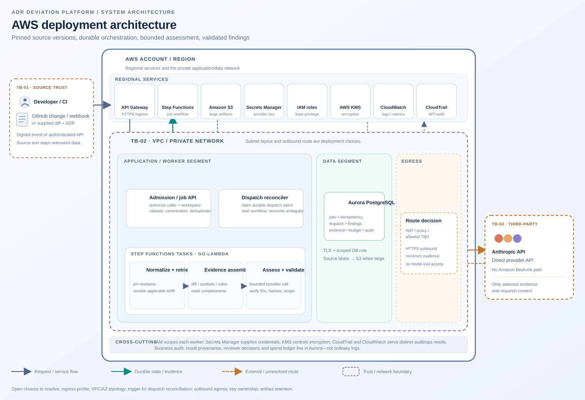
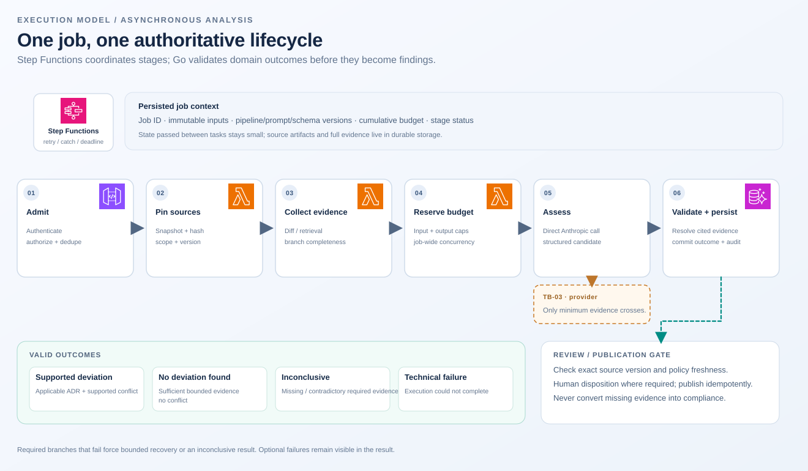
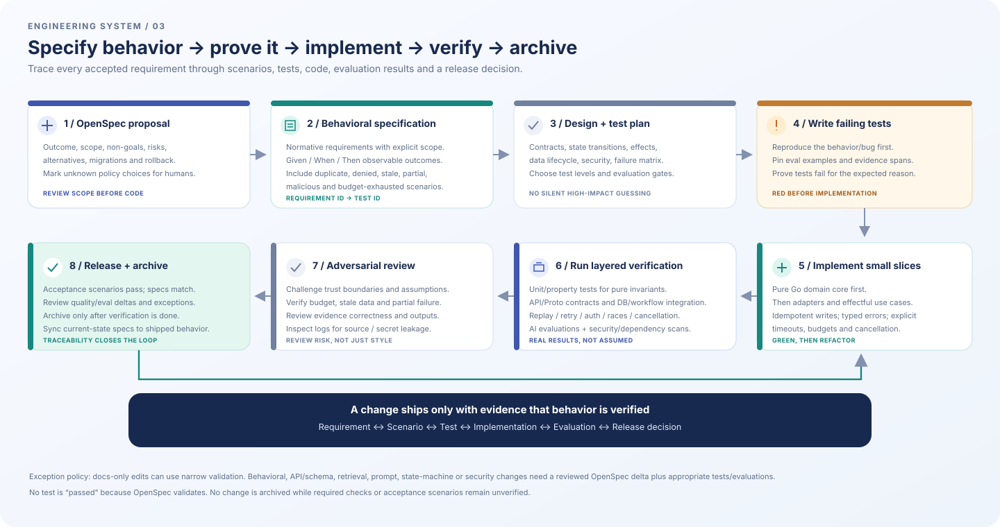
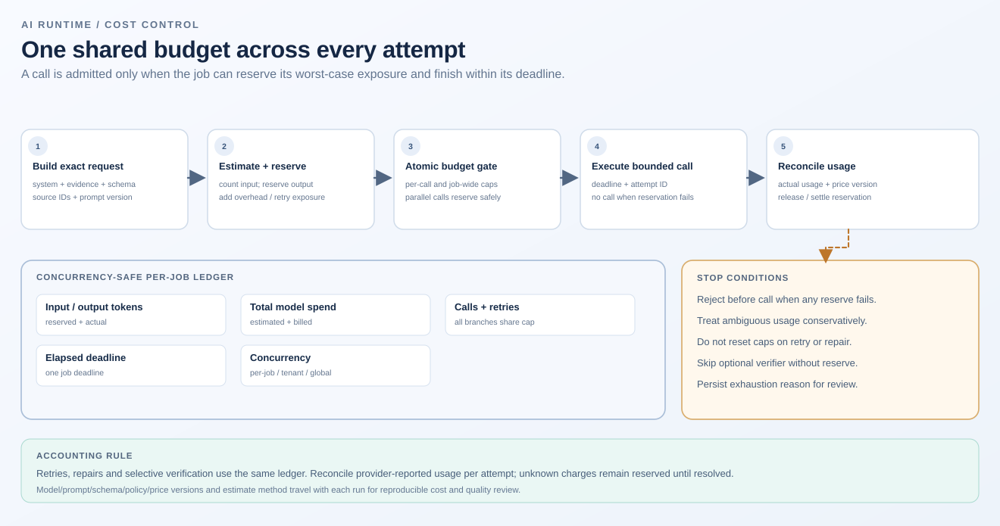

# Architecture and engineering diagrams

The diagrams are **reference designs**, not claims about deployed infrastructure. Their SVG source is checked into the repository so changes can be reviewed with the architecture and contracts.

## Reference architecture

The ingress validates identity, authorization and budget policy. Step Functions is the sole owner of distributed job lifecycle. Workers perform bounded steps. PostgreSQL is the authoritative store for jobs, findings, reviews, audit and usage accounting; S3 is optional for large immutable source snapshots. Model output is a candidate, never policy.

### Runtime profiles

| Profile | Use when | Trade-off |
|---|---|---|
| Serverless-first: API Gateway/HTTP + Go Lambda + Step Functions + worker Lambdas | Initial webhook and asynchronous API consumers | Keep ingress thin; manage cold starts and database connection scaling |
| Long-lived gRPC control plane: HTTPS ALB + Go gRPC on ECS/Fargate | A real client requires long-lived gRPC semantics | Adds always-on cost, health/rollout, scaling and network operations |
| Shared data plane: PostgreSQL/Aurora, S3 as needed, Secrets Manager, OpenTelemetry | Shared by either runtime profile | Define tenancy, retention, schema migrations and connection strategy before production |

Protobuf can remain contract-first even if the first public endpoint is HTTP/JSON. Do not host a gRPC server in ordinary Lambda. The provider direction is direct Anthropic API behind a typed Go harness.

## End-to-end analysis workflow

Key invariants: (1) commit a job and durable dispatch intent before returning acceptance; (2) reconcile workflow-start failures instead of leaving accepted jobs stranded; (3) source versions, parser, pipeline and policy are pinned; (4) every branch reports completeness; (5) retries use the same overall deadline and cumulative cost/call budgets; (6) findings are committed with evidence and provenance before publication; and (7) publication rechecks freshness and is idempotent.

## Functional, behavioral, and test-driven delivery

## Token and cost controls

## Authority by concern

| Concern | Authoritative owner | What must not happen |
|---|---|---|
| Identity and tenant scope | Ingress and server-side authorization | Model output never grants access |
| Async job lifecycle | Step Functions plus durable job/dispatch state | No competing agent graph or hidden orchestrator |
| Domain policy | Pure Go functions over explicit, versioned inputs | No policy implemented only in prompts or workflow expressions |
| Model requests | Typed harness: budget, versions, deadlines, retries | No unbounded tool loop or unbounded context |
| Provenance | Immutable artifact versions, stable locators and digest checks | Never silently fall back to latest source |
| Audit | Durable AuditEvent and ModelRun records | Traces are not a substitute for business audit |
| Quality | Unit/property/contract/integration tests plus labeled AI evaluations | A successful build or schema check is not behavioral proof |

See the [adversarial design review](ADVERSARIAL_DESIGN_REVIEW.md), [engineering playbook](ENGINEERING_PLAYBOOK.md), [AI pipeline](AI_PIPELINE.md), [functional-core review](FUNCTIONAL_CORE.md), [operations](OPERATIONS.md), and [OpenSpec workflow](OPEN_SPEC_WORKFLOW.md).
